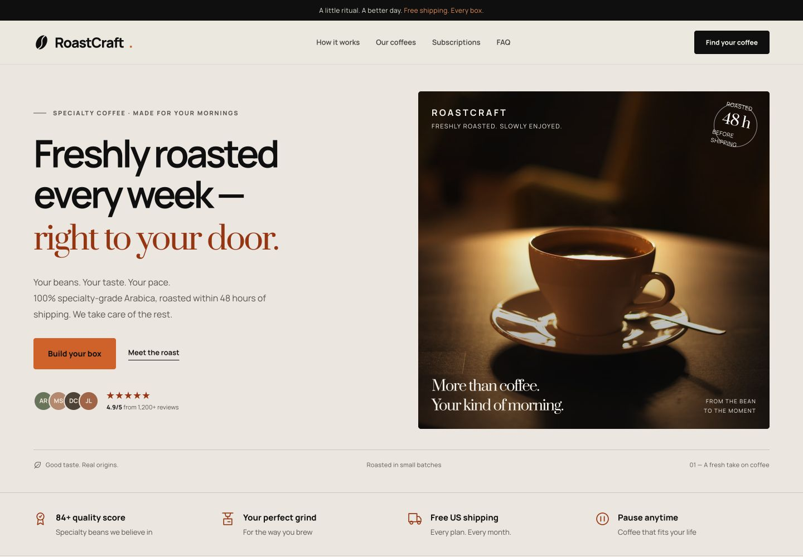

# RoastCraft

**Freshly roasted. Thoughtfully delivered.**

A premium landing page for a direct-to-consumer specialty coffee subscription. RoastCraft brings the coffee discovery experience online with a personalized flavor quiz, clear subscription pricing, and a guided checkout flow.



## The experience

- **Personalized coffee matching** — choose a brewing method and flavor profile to discover a recommended origin, tasting notes, price, and brewing recipe.
- **Three subscription plans** — Starter, Balanced, and Coffee Lover, with live monthly/annual pricing and an exact 15% annual discount.
- **Guided checkout** — the selected coffee, grind, plan, and billing frequency carry through to an accessible order dialog.
- **US localization** — English copy, USD prices, ounce/gram weights, Fahrenheit brewing temperatures, and email/US phone validation.
- **Complete brand story** — coffee origins, roasting process, customer stories, FAQ, and subscription information.

## Design & accessibility

Warm cream, deep graphite, and terracotta accents give the page a restrained editorial feel. Manrope and Prata pair crisp interface typography with a distinctive serif headline.

The layout adapts from 375 px mobile screens to 4K displays. It includes semantic HTML, keyboard navigation, visible focus states, native dialogs with focus restoration, reduced-motion support, smooth scrolling, and a mobile navigation menu.

## Built with

| Layer | Technology |
| --- | --- |
| Structure | HTML5 |
| Styling | CSS3, Grid, Flexbox, custom properties |
| Interactions | Vanilla JavaScript (ES6+) |
| Icons | Inline SVG |
| Fonts | Manrope & Prata via Google Fonts |
| Photography | Unsplash |

No framework, package installation, or build step is required. Styles and scripts live in one `index.html` file.

## Run locally

Open `index.html` in a modern browser, or serve the directory:

```sh
python3 -m http.server 8000
```

Then visit **http://localhost:8000**. Internet access is needed for fonts and photography; system fonts provide a fallback.

## Project structure

```text
roastcraft/
├── index.html    # Complete landing page, styles, and interactions
├── preview.png   # Desktop preview
├── README.md     # Project overview and setup
└── .gitignore
```

## Subscription pricing

| Plan | Monthly bags | Monthly | Annual total | Monthly equivalent |
| --- | --- | --- | --- | --- |
| Starter | 1 × 8.8 oz | $16 | $163.20 | $13.60 |
| Balanced | 2 × 8.8 oz | $29 | $295.80 | $24.65 |
| Coffee Lover | 4 × 8.8 oz | $54 | $550.80 | $45.90 |

Annual totals cover 12 monthly boxes. Shipping within the contiguous US and grinding are included in the example offer.

## Customization

Brand colors and typography are defined in the `:root` CSS variables. Coffee information and subscription pricing live in the `beans` and `plans` JavaScript objects. Edit the HTML to update copy, photography, contact details, and social links.

## Project scope

This is a frontend prototype. Checkout validates inputs and shows a local confirmation; it does not submit an order, store customer data, process payments, or manage active subscriptions. Connect an order API and payment provider before accepting real orders.

Prices, testimonials, ratings, customer names, and service promises are illustrative content. Replace them with verified business information before commercial use. `hello@roastcraft.example` is an example address. Finalize merchant details, shipping, cancellation/refund terms, privacy policy, and sales-tax handling for launch.

## Verification

Checked at 375, 768, 1024, 1440, and 3840 px with no horizontal overflow. The coffee quiz, checkout prefilling, contact validation, monthly/annual price calculations, mobile menu, and confirmation state have been verified in the browser.

## Photography

- [Tadeusz Zachwieja](https://unsplash.com/photos/a-coffee-cup-sitting-on-top-of-a-wooden-table-jlrQmaWJnp0) — hero photograph.
- [Amirhossein Soltani](https://unsplash.com/photos/a-coffee-roaster-is-filled-with-coffee-beans-_h8x2FMqiW0) — roasting photograph.

Photos are used under the [Unsplash License](https://unsplash.com/license). External photography and fonts retain their respective licenses.
